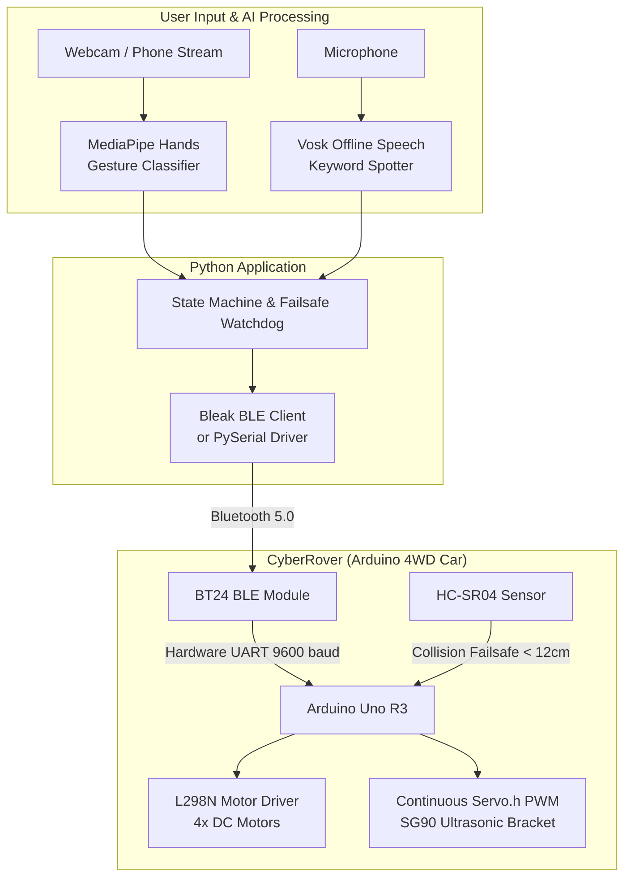

# 🏎️ CyberRover AI

[](https://www.python.org/)
[](https://developers.google.com/mediapipe)
[](https://alphacephei.com/vosk/)
[](https://github.com/hbldh/bleak)
[](https://www.arduino.cc/)
[]()

**CyberRover AI** is a multimodal smart robotics controller that allows you to drive an Arduino 4WD robotic car using **Computer Vision (Hand Gestures)** and **Real-Time Offline Voice Commands** over **Bluetooth Low Energy (BLE)**.

---

## 🌟 Highlights

### 🖐️ 1. Vision & Gesture Controller (`gesture_car.py`)
- **MediaPipe Hands Tracking**: 21 3D landmarks analyzed in real-time at 30+ FPS on CPU.
- **Steering Wheel Tilt (`math.atan2`)**: Turn left or right naturally by tilting your hand like an invisible steering wheel (`> 40°`), regardless of where your hand is positioned in the camera frame.
- **Euclidean Finger Extension**: Uses invariant wrist-to-finger Euclidean distance to accurately count fingers even when your hand is rotated.
- **Orientation Awareness**: Distinguishes back-of-hand (Forward) from palm (Backward) via 3D cross-product calculation.
- **Snappy Safety Stop**: Transitions to emergency stop in only 2 consecutive frames (~60ms) when a closed fist or no hand is detected.
- **Diagnostic HUD**: Real-time overlay showing handedness, extended fingers count, tilt angle in degrees, and active command state.

### 🎙️ 2. Offline Voice Controller (`voice_car.py`)
- **Vosk Speech-to-Text**: 100% offline, local speech recognition with **< 50ms latency** (no internet, no cloud APIs, zero subscription fees).
- **Strict Keyword Grammar**: Constrained language model that only listens for the allowed action words, eliminating false triggers.
- **Incremental Timed Steps**: Eliminates runaway continuous movement:
  - `"Forward"` $\rightarrow$ Moves forward for **1.0 second**, then auto-stops.
  - `"Back"` $\rightarrow$ Moves backward for **1.0 second**, then auto-stops.
  - `"Step"` $\rightarrow$ Nudges forward for **0.5 seconds**, then auto-stops.
  - `"Left"` $\rightarrow$ Turns left for **0.5 seconds**, then auto-stops.
  - `"Right"` $\rightarrow$ Turns right for **0.5 seconds**, then auto-stops.
  - `"Stop"` $\rightarrow$ Immediate emergency halt.
- **Continuous Watchdog Heartbeat**: Keeps sending keep-alive packets so the Arduino's 500ms safety timer doesn't disengage during active movements.

### 📡 3. Zero-Config Bluetooth Low Energy (BLE)
- Native communication with Keyestudio **BT24** (BLE 5.0) via transparent UART service (`0xFFE0` / `0xFFE1`).
- Eliminates macOS virtual serial port limitations (`/dev/cu.*` / `/dev/tty.*`).
- Auto-discovers and connects to `BT24` wirelessly without manual pairing.
- Also backward compatible with Classic Bluetooth (HC-05, HC-06) and USB serial cables.

---

## 🏗️ System Architecture



---

## 🛠️ Hardware Requirements

* **Car Chassis Kit**: Keyestudio 4WD Bluetooth Smart Car (or any Arduino Uno-based 4WD/2WD chassis).
* **Microcontroller**: Arduino Uno R3.
* **Bluetooth Module**: Keyestudio BT24 BLE (or HC-05 / HC-06 / HM-10).
* **Sensors & Actuators**:
  - HC-SR04 Ultrasonic Distance Sensor.
  - SG90 9g Micro Servo.
  - 8x16 LED Dot Matrix Display (optional visual feedback).
* **Computer**: macOS, Linux, or Windows with webcam and microphone.

---

## 🚀 Installation & Setup

### 1. Clone the Repository
```bash
git clone https://github.com/pedro48679/hand_car.git
cd hand_car
```

### 2. Create Virtual Environment & Install Dependencies
```bash
# Create virtual environment
python3 -m venv .venv

# Activate environment
# On macOS / Linux:
source .venv/bin/activate
# On Windows:
# .venv\Scripts\activate

# Install required packages
pip install -r requirements.txt
```

### 3. Flash the Arduino Code
1. Open the Arduino IDE.
2. Open [`lesson_17_Bluetooth_Multifunctional_Car/lesson_17_Bluetooth_Multifunctional_Car.ino`](lesson_17_Bluetooth_Multifunctional_Car/lesson_17_Bluetooth_Multifunctional_Car.ino).
3. ⚠️ **IMPORTANT**: **Unplug the Bluetooth module from pins 0 (RX) and 1 (TX)** before uploading, as it shares the USB serial line.
4. Connect the Arduino via USB and click **Upload**.
5. Once uploaded, disconnect the USB cable, plug the Bluetooth module back into the board, and turn on the car's battery switch.

---

## 🎮 How to Run

Make sure your virtual environment is active (`source .venv/bin/activate`) and the car power switch is **ON** (the Bluetooth LED will be blinking).

### Option 1: Hand Gesture Control (Camera)
```bash
python gesture_car.py
```
* **Auto-Connects**: Automatically scans for `BT24` over BLE; the car's LED will turn solid once connected.
* **Gestures**:
  - ✋ **Move Forward**: Open hand, back of hand facing camera.
  - 🤚 **Move Backward**: Open hand, palm facing camera.
  - ✊ **Emergency Stop**: Closed fist (or move hand out of frame).
  - 🔄 **Turn Left / Right**: Tilt hand left or right like a steering wheel (`> 40°`).
* **Exit**: Press **`Q`** in the video window.

> [!TIP]
> If you prefer using your open palm to move forward and back-of-hand for reverse, simply run with:
> ```bash
> python gesture_car.py --palm-forward
> ```

---

### Option 2: Voice Command Control (Microphone)
```bash
python voice_car.py
```
* **Commands**:
  - `"Forward"` $\rightarrow$ Steps forward for **1.0 second**.
  - `"Back"` $\rightarrow$ Steps backward for **1.0 second**.
  - `"Step"` $\rightarrow$ Nudges forward for **0.5 seconds**.
  - `"Left"` $\rightarrow$ Turns left for **0.5 seconds**.
  - `"Right"` $\rightarrow$ Turns right for **0.5 seconds**.
  - `"Stop"` $\rightarrow$ Instant emergency halt.
* **Exit**: Press **`Ctrl+C`** in the terminal.

> [!TIP]
> Customize movement durations on the fly:
> ```bash
> python voice_car.py --move-duration 1.5 --step-duration 0.3 --turn-duration 0.4
> ```

---

### Dry-Run Testing (No Car Needed)
You can test and tune both vision and voice recognition directly on your computer without connecting to the Arduino car:
```bash
# Test hand gesture tracking & HUD
python gesture_car.py --no-serial

# Test voice keyword spotting
python voice_car.py --no-serial
```

---

## 🔧 Calibration & Troubleshooting

### 1. Servo Facing Angle Calibration
If your ultrasonic sensor points slightly to the side when centered:
- In [`lesson_17_Bluetooth_Multifunctional_Car.ino`](lesson_17_Bluetooth_Multifunctional_Car/lesson_17_Bluetooth_Multifunctional_Car.ino), change:
  ```cpp
  int SERVO_FRONT_ANGLE = 0; // Adjust to 0, 90, or 180 depending on mechanical mounting
  ```
- Or physically unscrew the servo horn center screw, power the car, align the ultrasonic bracket straight forward, and push the horn back onto the gear.

### 2. macOS Camera Authorization
If OpenCV throws `OpenCV: not authorized to capture video`:
- Go to **System Settings > Privacy & Security > Camera**.
- Ensure access is allowed for your terminal application (Terminal, iTerm, or IDE).

### 3. Classic Bluetooth / USB Serial
If using a classic Bluetooth module (e.g. HC-05/HC-06) or direct USB cable instead of BLE:
```bash
python gesture_car.py --port /dev/cu.HC-06
python voice_car.py --port /dev/cu.HC-06
```

---

## 📜 License
This project is licensed under the [Apache-2.0 License](LICENSE).
