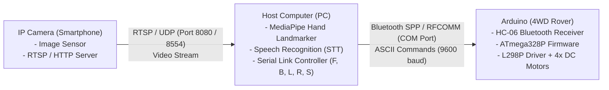

# Autonomous and Teleoperated 4WD Robotic Platform
## Multi-Modal Computer Vision (MediaPipe) and Acoustic Natural Language Control

---

## 1. System Architecture and Top-Level Topology

The system comprises three physical layers coupled over heterogeneous wireless links. Real-time telemetry, spatial vision inference, and voice processing are offloaded to an edge compute host (PC), reducing the embedded microcontroller's workload to deterministic motor actuation, PWM generation, and hardware failsafe monitoring.



---

## 2. Communications Infrastructure and Protocol Selection

### 2.1 Video Ingestion Transport: RTSP/UDP vs. HTTP/MJPEG vs. TCP

Low-latency visual teleoperation demands minimal end-to-end transport delay ($T_{\text{transport}} < 50\text{ ms}$). Transport protocol selection directly determines buffer bloat and queue latency:

```
TCP / HTTP Stream (Head-of-Line Blocking):
Packet N-1 [LOST] ---> Packet N [HELD IN OS BUFFER] ---> Packet N+1 [HELD] ---> Latency Accumulation (>= 500ms)

RTSP / UDP Stream (Loss-Tolerant, Real-Time):
Packet N-1 [LOST] ---> Packet N [DROPPED] ---> Packet N+1 [RENDERED IMMEDIATELY] ---> Constant Latency (<= 35ms)
```

| Evaluation Metric | RTSP over UDP | HTTP / MJPEG | Standard TCP Stream |
|---|---|---|---|
| **Underlying Layer 4 Protocol** | **UDP** | TCP | TCP |
| **Transmission Model** | Unacknowledged Datagram | Byte-stream over persistent socket | Stream socket |
| **Head-of-Line (HoL) Blocking** | **None** (Packets dropped on loss) | High (Retransmissions stall queue) | High (Guaranteed in-order delivery stalls pipeline) |
| **Transport Latency** | **15 - 35 ms** | 80 - 200 ms | > 300 ms under network jitter |
| **Encoding Compression** | H.264 / H.265 (Inter-frame predictive) | JPEG (Intra-frame only, high bitrate) | Variable |
| **Frame Degradation Mode** | Transient macroblocking / artifacting | Latency buildup; frame freezing | Total buffer pause |
| **Viability for Closed-Loop Robotics** | **Optimal** | Acceptable with aggressive queue purging | Unacceptable |

#### Zero-Latency OpenCV Queue Bypass
By default, the `libv4l`, `ffmpeg`, or `gstreamer` backends in OpenCV allocate internal multi-frame FIFO queues ($N \ge 5$ frames). In slow inference conditions, this FIFO introduces seconds of stale video latency.

The system enforces real-time synchronization through two architectural mechanisms:
1. **Hardware Buffer Size Constraint**: `cv2.CAP_PROP_BUFFERSIZE = 1`.
2. **Decoupled Asynchronous Frame Collector (`RealtimeCameraStream`)**: A dedicated background daemon thread continuously drains OS video sockets via blocking `cap.read()` cycles into a single-frame mutex slot. The main processing pipeline retrieves only the most recently written frame pointer, deterministically discarding intermediate stale frames with zero memory copies:

$$\text{Latency}_{\text{buffer}} = \Delta t_{\text{inter-frame}} \le 16.6\text{ ms (at 60 Hz)}$$

---

### 2.2 Host-to-Rover Telemetry: Bluetooth Classic SPP (RFCOMM)

Communication with the robot is established over **Bluetooth 2.0+EDR Serial Port Profile (SPP)** via an onboard **HC-06** baseband module mapped to the microcontroller hardware UART.

```
+--------------------------------------------------------------------------------+
| Host Application Layer (gesture_car.py / voice_car.py)                         |
|                                     |                                          |
|                          Single ASCII Byte Packet                              |
|                          ['F', 'B', 'L', 'R', 'S']                             |
|                                     v                                          |
| OS Virtual Serial Port (Windows COMx / POSIX /dev/rfcommX)                     |
|                                     |                                          |
|                       RFCOMM Packetization (L2CAP)                             |
|                                     v                                          |
| Host Bluetooth Baseband Controller (2.4 GHz FHSS ISM Band)                     |
|                                     |                                          |
|                     Wireless Radio Frequency Link (~10m)                       |
|                                     v                                          |
| HC-06 Bluetooth Transceiver (SPP Firmware)                                     |
|                                     |                                          |
|                       TTL Asynchronous Serial (UART)                           |
|                       Baud: 9600, Data: 8-bit, Parity: None, Stop: 1           |
|                                     v                                          |
| ATmega328P Hardware UART (UDR0 Register / USART RX ISR)                        |
+--------------------------------------------------------------------------------+
```

#### Serial Bandwidth and Latency Budget Calculation
The link operates at **9600 baud** (9600 symbols/sec). Under standard 8-N-1 framing:

$$\text{Bits Per Frame} = 1\text{ Start Bit} + 8\text{ Data Bits} + 0\text{ Parity} + 1\text{ Stop Bit} = 10\text{ bits/byte}$$

$$\text{Transmission Time per Byte} = \frac{10\text{ bits}}{9600\text{ bps}} \approx 1.042\text{ ms}$$

- **Packet Payload**: Single-byte atomic control tokens (`0x46` = 'F', `0x42` = 'B', `0x4C` = 'L', `0x52` = 'R', `0x53` = 'S').
- **Packet Ingestion Latency**: $\approx 1.04\text{ ms}$. This satisfies the embedded execution loop without filling the 64-byte hardware ring buffer of the Arduino core (`HardwareSerial`).
- **Telemetry Keepalive**: A periodic software watchdog heartbeat transmits every 300 ms, ensuring link validation and preempting the microcontroller's failsafe subroutines.

---

## 3. Subsystem 1: Ingestion and Spatial Frame Demuxing

The video ingestion subsystem bridges network streams to local shared memory.

```
                                  RealtimeCameraStream Pipeline
                                  
   RTSP/HTTP Source ---> [OS Socket Buffer] ---> cap.read() [Background Daemon Thread]
                                                        |
                                                        v
                                               [threading.Lock()]
                                                        |
                                               Atomic Frame Slot
                                            (Overwritten every frame)
                                                        |
                  Main Process <--- copy() <------------+
```

- **Thread Segregation**: Capturing runs isolated within a daemon thread, executing `cap.read()` in a tight loop sleeping for only 5 ms between cycles to avoid CPU thread starvation.
- **Mutual Exclusion (`threading.Lock`)**: The frame pointer is guarded by a lightweight mutex. Read operations perform a shallow atomic frame copy, preventing race conditions or partial frame read-tearing during classification.

---

## 4. Subsystem 2: Vision Pipeline and Kinematic Gesture Classification

Spatial hand tracking uses Google's **MediaPipe Gesture Recognizer** (Task Vision architecture) configured with single-hand tracking and normalized 3D coordinates:

$$\mathbf{P}_i = (x_i, y_i, z_i) \quad \text{where } x_i, y_i \in [0, 1], \; i \in [0, 20]$$

```
          Hand Landmark Topology (21 Keypoints)
          
                 [12]   [16]
           [8]     |      |    [20]
            |    [11]   [15]    |
           [7]     |      |    [19]
            |    [10]   [14]    |
           [6]     |      |    [18]
     [4]    \     [9]   [13]   /
      \      [5]----+------+--[17]
      [3]     |                 |
        \    /                   \
        [2] /                     \
         | |                       |
        [1]|                       |
         \ |                       /
          [0] <--- WRIST ----------+
```

### 4.1 Kinematic Feature Extraction Equations

#### Feature A: Rotation-Invariant Finger Extension
To distinguish closed fists from extended palms regardless of orientation, Euclidean metrics evaluate the fingertip relative to its proximal interphalangeal (PIP) joint and the wrist root ($\mathbf{P}_0$):

$$\mathcal{D}_{\text{tip}} = \|\mathbf{P}_{\text{tip}} - \mathbf{P}_0\|_2^2, \quad \mathcal{D}_{\text{pip}} = \|\mathbf{P}_{\text{pip}} - \mathbf{P}_0\|_2^2$$

$$\text{IsExtended}(\text{tip}, \text{pip}) = \left(\mathcal{D}_{\text{tip}} > 1.05 \cdot \mathcal{D}_{\text{pip}}\right) \lor (y_{\text{tip}} < y_{\text{pip}})$$

The total active count is evaluated over the four primary finger digits:

$$N_{\text{fingers}} = \sum_{k \in \{(8,6), (12,10), (16,14), (20,18)\}} \mathbb{I}(\text{IsExtended}(k_{\text{tip}}, k_{\text{pip}}))$$

#### Feature B: Planar Hand Tilt Angle ($\theta_{\text{tilt}}$)
Steering direction is governed by the planar tilt angle of the vector formed between the wrist ($\mathbf{P}_0$) and the middle finger metacarpophalangeal (MCP) knuckle base ($\mathbf{P}_9$):

$$\Delta x = x_9 - x_0, \quad \Delta y = y_9 - y_0$$

$$\theta_{\text{tilt}} = \text{atan2}(\Delta x, -\Delta y) \times \frac{180^\circ}{\pi}$$

- $\theta_{\text{tilt}} \in [-40^\circ, +40^\circ]$: Center (Forward / Backward trajectory)
- $\theta_{\text{tilt}} < -40^\circ$: Left steering actuation
- $\theta_{\text{tilt}} > +40^\circ$: Right steering actuation

#### Feature C: 3D Palm Normal and Planar Orientation
To resolve whether the user presents the palm surface (backward motion) or dorsal surface (forward motion), the cross product of the planar palm triangle is calculated:

$$\mathbf{v}_A = \mathbf{P}_5 - \mathbf{P}_0 \quad (\text{Wrist to Index MCP})$$

$$\mathbf{v}_B = \mathbf{P}_{17} - \mathbf{P}_0 \quad (\text{Wrist to Pinky MCP})$$

$$\mathbf{N}_z = (\mathbf{v}_{A,x} \cdot \mathbf{v}_{B,y}) - (\mathbf{v}_{A,y} \cdot \mathbf{v}_{B,x})$$

Accounting for hand chirality (left vs. right handedness):

$$\text{FacingCamera} = \begin{cases} 
\text{Palm (Front)}, & \text{if } (\text{Chirality} = \text{Right} \land \mathbf{N}_z > 0) \lor (\text{Chirality} = \text{Left} \land \mathbf{N}_z < 0) \\
\text{Dorsal (Back)}, & \text{otherwise}
\end{cases}$$

### 4.2 State Machine and Hysteresis Smoothing
To prevent signal bounce across noisy video frames, spatial classifications traverse a temporal hysteresis debounce filter:

```
[Raw Frame Classifier]
         |
         v
 Candidate Gesture (g)
         |
         +---> if g == candidate_history: count++
         +---> else: count = 1, candidate_history = g
         |
         v
[Hysteresis Gate]
         +---> if candidate == 'S' and count >= 2 ---> Commit 'S' (Emergency Fast Path)
         +---> if candidate != 'S' and count >= 4 ---> Commit Directional Command
         +---> else ---> Retain Previous Committed State
```

---

## 5. Subsystem 3: Microcontroller Firmware and Differential Motion Control

The onboard ATmega328P operates a dual-axis decoupled kinematic controller separating translation mode (`drive_mode`) from rotational bias (`steer_mode`).

### 5.1 Decoupled State Machine Mechanics

```
                 Decoupled State Machine Architecture
                 
            drive_mode in {'F', 'B', 'S'}  (Translation State)
            steer_mode in {'L', 'R', 'C'}  (Curvature State)
            
                   +---------------------------------+
                   |    Command Matrix Execution     |
                   +----------------+----------------+
                                    |
       +----------------------------+----------------------------+
       |                            |                            |
       v                            v                            v
  drive_mode = 'F'             drive_mode = 'B'             drive_mode = 'S'
  +-- steer_mode = 'C':        +-- steer_mode = 'C':        +-- steer_mode = 'C':
  |   Both sides forward       |   Both sides reverse       |   All PWM = 0 (Stop)
  +-- steer_mode = 'L':        +-- steer_mode = 'L':        +-- steer_mode = 'L':
  |   Left=35%, Right=100%     |   Left=35%, Right=100%     |   Counter-rotate Left
  +-- steer_mode = 'R':        +-- steer_mode = 'R':        +-- steer_mode = 'R':
      Left=100%, Right=35%         Left=100%, Right=35%         Counter-rotate Right
```

### 5.2 Differential Kinematics and Motor Drive Matrix

The platform employs skid-steering across four geared DC motors paired into two parallel banks (Group A: Right, Group B: Left) controlled via an **L298P Dual Full-Bridge Driver**.

$$\text{Inner Wheel Speed} = V_{\text{inner}} = \lfloor V_{\text{base}} \times 0.35 \rfloor$$

| Drive Mode | Steer Mode | Left Bank Logic (`D2`) | Left Bank PWM (`D5`) | Right Bank Logic (`D4`) | Right Bank PWM (`D6`) | Physical Vehicle Kinematics |
|:---:|:---:|:---:|:---:|:---:|:---:|---|
| **`F`** | **`C`** | `HIGH` | $255 - V_{\text{base}}$ | `HIGH` | $255 - V_{\text{base}}$ | Straight linear forward translation |
| **`F`** | **`L`** | `HIGH` | $255 - V_{\text{inner}}$ | `HIGH` | $255 - V_{\text{base}}$ | Continuous smooth left forward arc |
| **`F`** | **`R`** | `HIGH` | $255 - V_{\text{base}}$ | `HIGH` | $255 - V_{\text{inner}}$ | Continuous smooth right forward arc |
| **`B`** | **`C`** | `LOW` | $V_{\text{base}}$ | `LOW` | $V_{\text{base}}$ | Straight linear reverse translation |
| **`B`** | **`L`** | `LOW` | $V_{\text{inner}}$ | `LOW` | $V_{\text{base}}$ | Continuous smooth left reverse arc |
| **`B`** | **`R`** | `LOW` | $V_{\text{base}}$ | `LOW` | $V_{\text{inner}}$ | Continuous smooth right reverse arc |
| **`S`** | **`L`** | `LOW` | $V_{\text{base}}$ | `HIGH` | $255 - V_{\text{base}}$ | Stationary zero-radius axial turn left |
| **`S`** | **`R`** | `HIGH` | $255 - V_{\text{base}}$ | `LOW` | $V_{\text{base}}$ | Stationary zero-radius axial turn right |
| **`S`** | **`C`** | `LOW` | $0$ | `LOW` | $0$ | Complete dynamic motor stop |

*(Note: The L298P shield configuration dictates that active forward motor drive corresponds to inverted PWM logic `255 - speeds` under `HIGH` direction logic).*

### 5.3 Hardware Interfacing and Pin Map

| ATmega328P Pin | Functional Mapping | Hardware Peripheral | Direction / Electrical Type |
|---|---|---|---|
| **`D0` (RX)** | Bluetooth Telemetry Ingest | USART Native Hardware Receiver | TTL Input (from HC-06 TX) |
| **`D1` (TX)** | Microcontroller Debug Return | USART Native Hardware Transmitter | TTL Output (to HC-06 RX) |
| **`D2`** | Left Motor Direction Logic | Digital GPIO | Output (Group B Direction Control) |
| **`D5`** | Left Motor Speed (PWM) | Timer0 OC0B 8-bit Phase PWM | Active Output ($0 - 255$) |
| **`D4`** | Right Motor Direction Logic | Digital GPIO | Output (Group A Direction Control) |
| **`D6`** | Right Motor Speed (PWM) | Timer0 OC0A 8-bit Phase PWM | Active Output ($0 - 255$) |
| **`D12`** | Sonar Trigger Signal | Digital GPIO | Output ($10\text{ }\mu\text{s}$ pulse generation) |
| **`D13`** | Sonar Receiver Echo | Digital GPIO / Pin Change Interrupt | Input (Pulse measurement) |
| **`A3`** | Obstacle Sensor Pan Servo | Timer1 PWM Servo Driver | PPM Control Signal ($50\text{ Hz}$) |
| **`A4`** | LED Matrix Data (`SDA`) | Bit-Banged Serial Bus | Open-Drain Active Drive |
| **`A5`** | LED Matrix Clock (`SCL`) | Bit-Banged Clock Bus | Active Shift Output |

### 5.4 Embedded Protection and Hardware Timers

1. **Auto-Center Steering Timeout**: If steering commands (`L`, `R`) cease while driving forward or backward, a 400 ms non-blocking monotonic timer (`STEER_TIMEOUT_MS`) trips:
   ```cpp
   if (steer_mode != 'C' && (millis() - last_steer_time > STEER_TIMEOUT_MS)) {
       steer_mode = 'C';
       update_motors();
   }
   ```
2. **Ultrasonic Collision Interrupter**: While moving in forward mode (`drive_mode == 'F'`), ranging runs cyclically every 60 ms. If an obstacle appears within 15 cm:
   $$\text{Distance} = \frac{T_{\text{pulse}} (\text{us})}{58} \le 15\text{ cm} \implies \mathrm{drive\_mode} \leftarrow \text{'S'}, \; \mathrm{steer\_mode} \leftarrow \text{'C'}$$
   Crucially, `pulseIn(echoPin, HIGH, 25000)` enforces a strict **25 ms watchdog timeout** (~4.3 m acoustic ceiling), preventing the default 1000 ms blocking timeout of the Arduino core from halting motor loop execution.

---

## 6. Subsystem 4: Voice Command Acoustic Pipeline

The acoustic control subsystem operates in parallel or standalone, processing natural language intents via real-time speech tokenization:

```
[Microphone Audio Input]
         |
         v
[Energy-Threshold VAD (300 Ambient Calibration)]
         |
         v
[Audio Stream Slicing (Max 3.0s Phrase Limit)]
         |
         v
[Google Speech Recognition Cloud Endpoint]
         |
         v
[Lexical Tokenizer and Stop Preemption Search]
         +---> If "stop" / "halt" / "brake" found ---> Immediate 'S' Dispatch
         +---> Else match tail keyword against command map
         |
         v
[Threaded Monostable Pulse Dispatcher]
         +---> 'F' / 'B' ---> Send Byte ---> Timer(1.0s, auto_stop)
         +---> 'L' / 'R' ---> Send Byte ---> Timer(0.5s, auto_stop)
         +---> 'S'       ---> Cancel active timers ---> Send 'S'
```

### 6.1 Lexical Parsing and Intent Prioritization

The lexer scans spoken strings in reverse order (newest tokens take precedence) while executing an absolute pre-search for safety stop words:

$$\text{Tokens} = \text{Lower}(\text{Phrase}) \setminus \{\text{Punctuation}\} \to [w_0, w_1, \dots, w_k]$$

$$\text{Safety Override}: \quad \exists w_i \in \{\text{"stop"}, \text{"halt"}, \text{"brake"}, \text{"wait"}\} \implies \text{Command} = \text{'S'}$$

### 6.2 Pulse Duration Control

To guarantee fail-safe motion when audio connectivity fluctuates, voice mode translates speech utterances into **bounded time-domain actuation pulses**:

$$\Delta t_{\text{pulse}} = \begin{cases} 
1.00\text{ s}, & \text{for translation } ('F', 'B') \\
0.50\text{ s}, & \text{for rotation } ('L', 'R') \\
0.00\text{ s}, & \text{for stop } ('S')
\end{cases}$$

Active timers are instantiated using daemon threads (`threading.Timer`). Arrival of a subsequent token or a stop assertion instantaneously preempts and cancels existing timer instances using a re-entrant mutex lock.

---

## 7. End-to-End Latency and Telemetry Timing Budget

The complete pipeline latency from physical human movement or speech emission to motor torque response is governed by deterministic stages:

### Gesture Control Pipeline Budget

```
Ingestion         Inference         Hysteresis Filter   Serial Transmit     Motor Rise
[15 - 30ms] --->  [12 - 18ms] --->  [4 Frames @ 30fps] --->  [1.04ms]   ---> [10 - 20ms]
 Camera Frame     MediaPipe Task       Debounce Gate      Bluetooth UART     L298P H-Bridge
```

| Pipeline Segment | Minimum Delay | Nominal Delay | Maximum Delay | Operational Determinant |
|---|:---:|:---:|:---:|---|
| **Network Video Streaming (UDP/RTSP)** | 10 ms | 20 ms | 45 ms | WLAN bandwidth / packet jitter |
| **Frame Capture and Buffer Retrieval** | 0.5 ms | 1.0 ms | 5.0 ms | OS thread context switch / lock sync |
| **MediaPipe Landmark Inference** | 8 ms | 14 ms | 22 ms | Host CPU / GPU SIMD capabilities |
| **Hysteresis Debounce Gate** | 33 ms | 66 ms | 132 ms | Configured frame requirement (2 to 4 frames) |
| **Bluetooth Telemetry Transmission** | 1.04 ms | 1.04 ms | 2.08 ms | 9600-8-N-1 UART symbol timing |
| **Microcontroller Command Execution** | 0.05 ms | 0.10 ms | 0.25 ms | Loop cycle time and USART RX ISR |
| **L298P Inductive Rise Time** | 5.0 ms | 10.0 ms | 20.0 ms | Motor winding inductance and current limit |
| **Total Response Latency** | **~57 ms** | **~112 ms** | **~224 ms** | **Sub-quarter-second control loop** |

---

## 8. Command Protocol Reference

The table below outlines all supported serial control codes:

| ASCII Byte | Hex Value | Direction / Mode | Microcontroller Internal Action |
|:---:|:---:|---|---|
| `'F'` | `0x46` | Forward Motion | `drive_mode = 'F'`, resets `steer_mode = 'C'`, sets direction pins `HIGH`, updates PWM |
| `'B'` | `0x42` | Backward Motion | `drive_mode = 'B'`, resets `steer_mode = 'C'`, sets direction pins `LOW`, updates PWM |
| `'L'` | `0x4C` | Steer Left | `steer_mode = 'L'`, resets `last_steer_time = millis()`, adjusts differential wheel speeds |
| `'R'` | `0x52` | Steer Right | `steer_mode = 'R'`, resets `last_steer_time = millis()`, adjusts differential wheel speeds |
| `'S'` | `0x53` | Failsafe Stop | `drive_mode = 'S'`, `steer_mode = 'C'`, zeros PWM outputs on all H-bridge channels |
| `'a'` | `0x61` | Accelerate | Increments speed variable (+20 PWM), clamped at 255 |
| `'d'` | `0x64` | Decelerate | Decrements speed variable (-20 PWM), clamped at 50 |
| `'U'` | `0x55` | Autonomous Follow | Halts manual state, engages servo sweep and ultrasonic distance maintenance loop |
| `'Y'` | `0x59` | Autonomous Avoid | Halts manual state, runs obstacle collision scan and trajectory deviation loop |
| `'G'` | `0x47` | Confinement Mode | Reads 3x TCRT5000 infrared reflectance pins, enforces border boundary containment |
| `'X'` | `0x58` | Line Tracking | Reads 3x TCRT5000 sensors, activates closed-loop trajectory tracking along black tape lines |

---

## 9. Hardware Configuration and Wiring Schematics

### 9.1 High-Current Motor Subsystem
```
                                        +---------------------+
                                        |  External Battery   |
                                        |  (7.4V - 11.1V LiPo)|
                                        +----------+----------+
                                                   | (+)
                                                   v
+---------------------+     Control Logic     +----+----------------+    Motor Drive    +---------------------+
|                     |--- Pin 2 (Dir B) ---->|                     |--- Out 1 & 2 ---->| Left Bank Motors    |
|   Arduino UNO       |--- Pin 5 (PWM B) ---->|   L298P Driver      |                   | (Front & Rear Left) |
|   (ATmega328P)      |--- Pin 4 (Dir A) ---->|   Shield Board      |                   +---------------------+
|                     |--- Pin 6 (PWM A) ---->|                     |--- Out 3 & 4 ---->| Right Bank Motors   |
+----------+----------+                       +----------+----------+                   | (Front & Rear Right)|
           |                                             |                              +---------------------+
           +----------------- Common GND ----------------+
```

### 9.2 Sensor and Telemetry Pinout
```
     Arduino UNO (ATmega328P)                        Peripherals
   +--------------------------+               +-----------------------+
   |                 Pin 0/RX |<--------------| TXD (HC-06 Bluetooth) |
   |                 Pin 1/TX |-------------->| RXD (HC-06 Bluetooth) |
   |                          |               +-----------------------+
   |                Pin 12/D12|-------------->| TRIG (HC-SR04 Sonar)  |
   |                Pin 13/D13|<--------------| ECHO (HC-SR04 Sonar)  |
   |                    Pin A3|-------------->| Signal (Sonar Servo)  |
   |                          |               +-----------------------+
   |                    Pin A4|-------------->| SDA (LED Matrix I2C)  |
   |                    Pin A5|-------------->| SCL (LED Matrix I2C)  |
   +--------------------------+               +-----------------------+
```

---

## 10. Execution Reference

### 10.1 Environment Provisioning
```bash
# Provision isolated Python virtual environment
python -m venv .venv
source .venv/bin/activate        # Linux/macOS
.venv\Scripts\activate           # Windows

# Install direct runtime dependencies
pip install opencv-python>=4.9.0 mediapipe>=0.10.14 pyserial>=3.5 numpy>=1.24.0 SpeechRecognition pyaudio
```

### 10.2 Production Execution Commands

```bash
# Gesture Control: Remote IP Stream + Bluetooth Telemetry
python gesture_car.py --stream http://192.168.1.85:8080/video --port COM5

# Gesture Control: Local PC Webcam Verification (Dry-Run / No Serial)
python gesture_car.py --no-serial

# Gesture Control: Unflipped Camera Ingestion
python gesture_car.py --stream http://192.168.1.85:8080/video --port COM5 --mirror

# Voice Control: Active Hardware Bluetooth Loop
python voice_car.py --port COM5

# Voice Control: Dry-Run Verification with Custom Energy Threshold
python voice_car.py --no-serial --energy-threshold 250
```

---

## 11. Technical Specifications Summary

| Property | Value / Specification |
|---|---|
| **MCU Architecture** | 8-bit Microchip ATmega328P @ 16 MHz |
| **Operating Voltage** | Logic: 5V DC, Motor Rail: 7.4V - 11.1V (External 18650 Pack) |
| **Motor Drive Topology** | Dual Full-Bridge L298P with Inverted Complementary PWM Modulation |
| **Serial Telemetry Protocol** | Bluetooth 2.0+EDR SPP / RFCOMM, 9600-8-N-1 (Non-blocking UART) |
| **Computer Vision Engine** | Google MediaPipe Gesture Recognizer (Task API, 21 Keypoints, 3D Vector Space) |
| **Video Transport Options** | RTSP/UDP (H.264), HTTP/MJPEG, Direct V4L2/DirectShow Camera Ingest |
| **Acoustic Parsing Engine** | SpeechRecognition API with Preemptive Safety Lexical Interceptor |
| **Obstacle Protection** | Ultrasonic Ranging (40 kHz) with 25 ms Hardware Timeout Protection |
| **Fail-Safe Mechanisms** | Host Watchdog (300 ms), Firmware Steering Auto-Center (400 ms), Collision Override (<= 15 cm) |
| **License** | [Apache License 2.0](LICENSE) |
